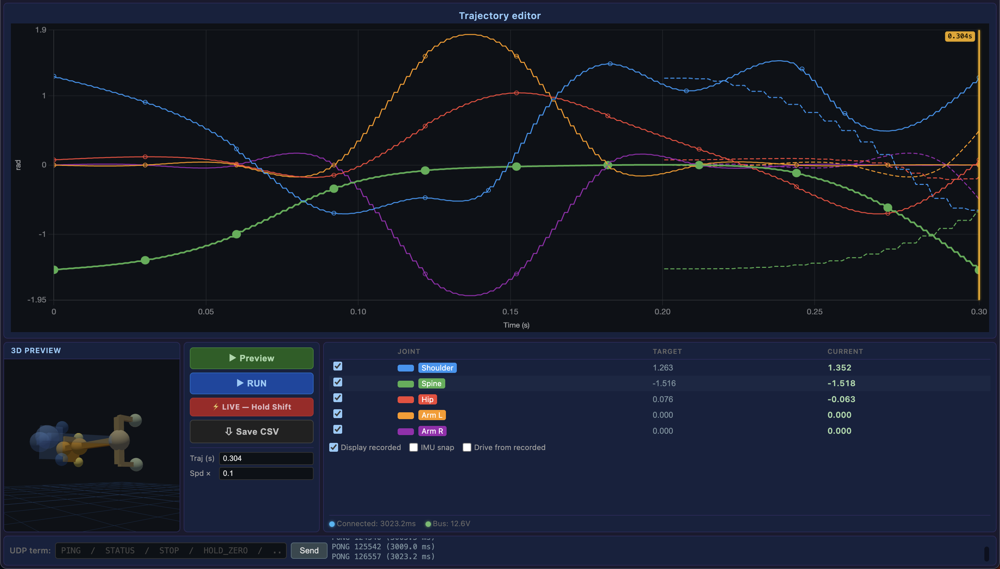

# Robot GUI

[Open the robot GUI](https://qwertpas.github.io/pinto2-gui/)

Trajectory editor, 3D preview, gamepad control, live telemetry, and run recording for squirrel2-now.

1. Open the link in your browser using desktop Chrome or Edge.
2. Plug the ESP-NOW USB bridge into your computer and power the robot.
3. Click **Connect USB** and select the bridge. Close any other program using the bridge first.
4. Use the same editor, preview, Shift live-follow, RUN, gamepad, gain controls, and log export.

**Save traj** keeps the trajectory in this browser and downloads a CSV. **Local CSV** imports it on another computer. The saved trajectory menu also includes the published library.

The page is accessible anywhere. Robot control requires the USB bridge connected to the computer running the browser, within radio range of the robot.
